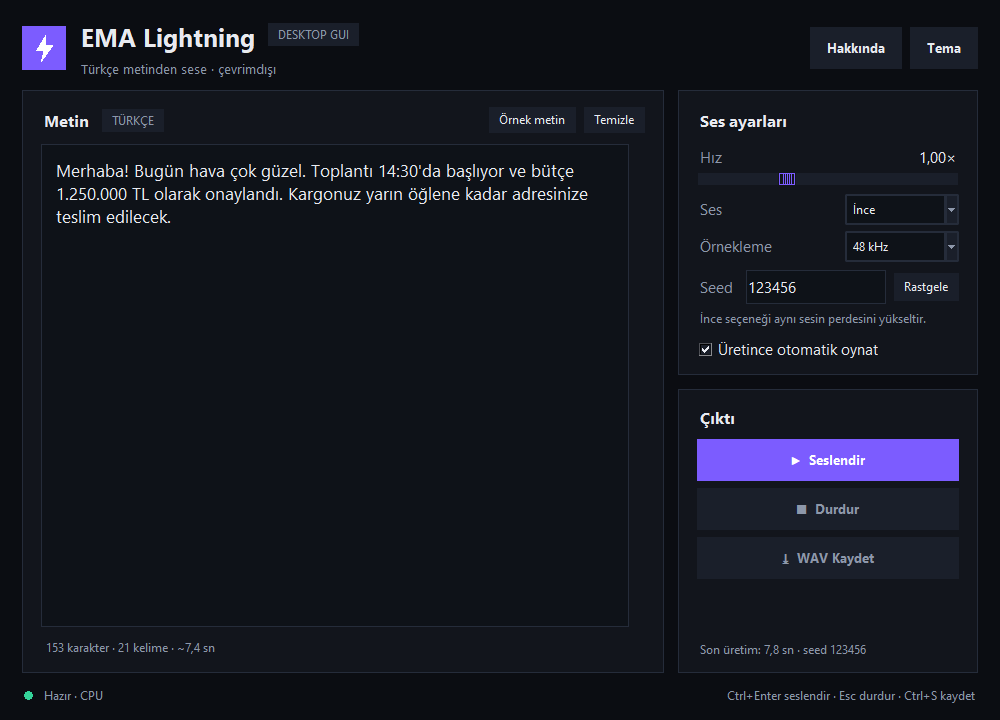

# ⚡ EMA Lightning Desktop GUI

> [canberk7/ema-lightning](https://github.com/canberk7/ema-lightning) projesinin
> üzerine kurulu masaüstü arayüz. Kütüphane ve motor orijinal projeden gelir;
> arayüz ve tasarım: [@byfinega](https://github.com/byfinega).



Türkçe bir metni yazıp anında seslendiren küçük bir masaüstü uygulaması. Motoru,
8,6M parametreli [EMA Lightning](https://github.com/canberk7/ema-lightning)
kütüphanesidir; her şey kendi makinenizde çalışır ve tamamen çevrimdışıdır —
metin ve ses hiçbir yere gitmez.

## Arayüzde neler var?

- Büyük metin alanı; karakter/kelime sayısı ve tahmini süre
- 0,5× – 2,0× hız kaydırıcısı
- **Ses seçenekleri:** `EMA · özgün` ve `İnce` — model tek konuşmacılı olduğu
  için `İnce`, aynı sesi yeniden örnekleyerek perdesini yaklaşık 2 yarım ton
  yükselten bir varyanttır; ayrı bir konuşmacı kaydı değildir
  ([ses seçenekleri](docs/desktop.md#ses-seçenekleri))
- 48 / 24 / 16 / 8 kHz çıktı seçimi ve isteğe bağlı `seed`
  (boş bırakılırsa rastgele seçilir ve sonuçta gösterilir)
- Üretince otomatik oynatma; tek düğmeyle WAV kaydetme
- Koyu ve açık tema
- Kısayollar: `Ctrl+Enter` seslendir, `Esc` durdur, `Ctrl+S` kaydet
- Sağ tık menüsü: kes, kopyala, yapıştır, tümünü seç

Metniniz hiçbir zaman kaydedilmez; yalnızca son üretilen ses geçici bir WAV
dosyasında tutulur ve uygulama kapanınca silinir.

## Kurulum

Python 3.11 – 3.13 gerekir.

```powershell
git clone https://github.com/byfinega/ema-lightning-gui.git
cd ema-lightning-gui
py -3.13 -m venv .venv
.venv\Scripts\Activate.ps1

# NVIDIA GPU yoksa CPU sürümü:
python -m pip install torch --index-url https://download.pytorch.org/whl/cpu

python -m pip install -e ".[dev]"
python -m ema_lightning
```

İlk açılışta model ağırlıkları (~34 MB) Hugging Face'ten indirilir; sonrasında
uygulama tamamen çevrimdışı çalışır. Kurulumdan sonra `ema-lightning` veya
`ema-lightning-desktop` komutu da aynı pencereyi açar. Ağırlıkları önceden
indirip `weights\` klasörüne koyarsanız ilk açılış da çevrimdışı olur.

## EXE oluşturma

```powershell
powershell -ExecutionPolicy Bypass -File scripts\build_exe.ps1
```

Çıktı: `dist\EMA-Lightning-Desktop-GUI\EMA-Lightning-Desktop-GUI.exe` (klasör
derlemesi; `-OneFile` tek dosya yapar, `-WithWeights` ağırlıkları gömer, `-Cuda`
CUDA derler). Boyutlar, derleme süreleri ve sorun giderme için
[masaüstü rehberine](docs/desktop.md) bakın.

## Motor: EMA Lightning

Arayüzün arkasındaki motor, Canberk Aslan'ın
[EMA Lightning](https://github.com/canberk7/ema-lightning) kütüphanesidir. Öne
çıkanlar:

| | |
|---|---|
| Boyut | 8,6M parametre (~34 MB), Apache-2.0 |
| Doğruluk | Freya-TR-Eval'de %0,92 WER — ElevenLabs v4, Gemini 3.8 ve 2,38B'lik Trendyol-TTS dâhil ölçülen tüm sistemlerin en düşüğü |
| Hız | İlk ses ~4 ms; tek istek 440×, batch ile 1.316× gerçek zaman (RTX 4090) |
| Türkçe | Sayı, tarih, para, birim ve kısaltmaları okuyan normalizer-tr normalizasyonu |
| Akış | Ses üretilirken dinlenebilir; tek model, Playhead zamanlayıcısıyla çok sayıda çağırıcıya hizmet eder |

Kütüphane olarak kullanım:

```python
from ema_lightning import EMA

tts = EMA()
speech = tts.say("Merhaba, size nasıl yardımcı olabilirim?", path="merhaba.wav")
print(speech.duration, speech.sample_rate)
```

Kütüphanenin tam dokümanı: [API](docs/api.md) · [Metin](docs/text.md) ·
[Çok çağırıcı](docs/scheduling.md) · [Performans](PERFORMANCE.md) ·
[orijinal README](https://github.com/canberk7/ema-lightning#readme).

```bibtex
@misc{aslan2026emalightning,
  title        = {EMA Lightning: Tiny, Fast and Accurate Turkish Text to Speech},
  author       = {Aslan, Canberk},
  year         = {2026},
  howpublished = {\url{https://huggingface.co/canberkkkkkk/ema-lightning}}
}
```

## Belgeler

| Rehber | İçerik |
|---|---|
| [Masaüstü rehberi](docs/desktop.md) | Arayüz: ses seçenekleri, EXE derleme, sorun giderme, günlük ve ayarlar |
| [API referansı](docs/api.md) | `EMA` ve `Speech`: her sınıf, yöntem, seçenek ve hata |
| [Metin](docs/text.md) | Normalizasyon, alfabe, bölme ve duraklar |
| [Çok çağırıcı](docs/scheduling.md) | Playhead'in iki kuyruğu, pencereler ve batch'ler |
| [Performans](PERFORMANCE.md) | Doğruluk ve hız, nasıl ölçüldü |
| [Katkı](CONTRIBUTING.md) | Kurulum, kod düzeni, testler ve kontroller |
| [Changelog](CHANGELOG.md) | Sürümlere göre değişiklikler |

## Teşekkür

- **[Canberk Aslan](https://github.com/canberk7)** — EMA Lightning motoru
- **[Erdem Tuna](https://github.com/erdemtuna)** —
  [normalizer-tr](https://github.com/erdemtuna/normalizer-tr): duyduğunuz her
  sayı, tarih ve para onun işi
- Freya-TR-Eval kıyaslaması için Freya; yayımlanmış tabanlar için Anka TTS
  yazarları

## Lisans

[Apache-2.0](LICENSE) — hem kod hem ağırlıklar; ticari kullanım dâhil.
normalizer-tr de Apache-2.0'dır.
