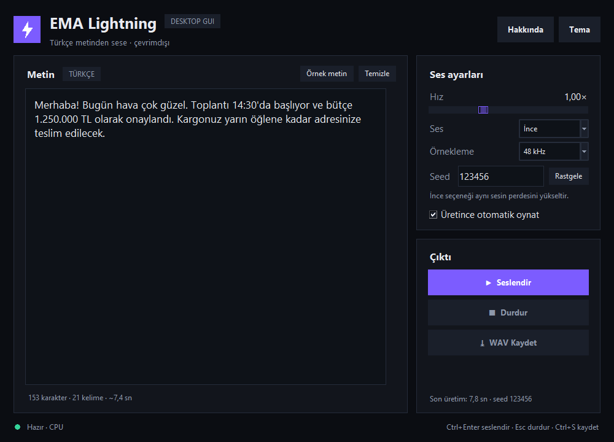

# EMA Lightning Desktop GUI



EMA Lightning Desktop GUI, EMA Lightning motorunun Tkinter tabanlı masaüstü
arayüzüdür: Türkçe bir metni yazıp dinlemek ve WAV olarak kaydetmek için
tasarlanmış küçük bir Windows aracıdır. Arayüz modeli arka planda yükler; yazma,
seslendirme ve oynatma sırasında donmaz.

## Neler var?

- Büyük bir metin alanı, karakter/kelime sayısı ve tahmini süre
- 0,5× – 2,0× hız kaydırıcısı
- Ses seçenekleri: özgün ses ve ince (perdesi yükseltilmiş) varyant
- 48 / 24 / 16 / 8 kHz çıktı seçimi
- İsteğe bağlı `seed` (boş bırakılırsa rastgele seçilir ve sonuçta gösterilir)
- Üretince otomatik oynatma
- Tek düğmeyle WAV kaydetme
- Koyu ve açık tema
- `Ctrl+Enter` ile seslendir, `Esc` ile durdur, `Ctrl+S` ile kaydet
- Sağ tık menüsü: kes, kopyala, yapıştır, tümünü seç

Metin hiçbir zaman kaydedilmez. Yalnızca son üretilen ses, geçici bir WAV
dosyasında tutulur; uygulama kapanınca silinir.

## Ses seçenekleri

Model **tek konuşmacılıdır**: eğitim verisi tek bir sesle toplanmış ve ağırlıklarda
konuşmacı girişi yoktur. Bu yüzden arayüzdeki seçenekler yeni bir konuşmacı
üretmez; aynı sesin perdesini ve formantlarını dönüştürür:

| Seçenek | Ne yapar |
|---|---|
| `EMA · özgün` | Modelin kendi sesi, hiçbir dönüşüm yok |
| `İnce` | Perde yaklaşık 2 yarım ton yükselir; aynı sesin daha tiz, daha aydınlık hâli |

Dönüşüm, üretilen sesin yeniden örneklenmesiyle yapılır. Süre değişmesin diye
model, seçilen perde kadar daha yavaş konuşturulur ve ses aynı oranda hızlandırılır;
yani hız kaydırıcısının söylediği süre korunur. Başka bir konuşmacı gerekiyorsa çok
konuşmacılı veya ses klonlayabilen bir model gerekir; bu arayüz onu sağlamaz.

## Kaynaktan çalıştırma

Python 3.11 – 3.13 gerekir.

```powershell
cd <depo-klasörü>            # örn. C:\src\ema-lightning
py -3.13 -m venv .venv
.venv\Scripts\Activate.ps1

# NVIDIA GPU yoksa CPU sürümü:
python -m pip install torch --index-url https://download.pytorch.org/whl/cpu

python -m pip install -e ".[dev]"
python -m ema_lightning
```

Kurulumdan sonra `ema-lightning` veya `ema-lightning-desktop` komutu da aynı
arayüzü açar. İlk açılışta model ağırlıkları (yaklaşık 34 MB) Hugging Face'ten
indirilir; sonrasında uygulama çevrimdışı çalışır. Ağırlıkları önceden indirip
`weights\` klasörüne koyarsanız ilk açılış da çevrimdışı olur:

```text
weights\
  ema.pt
  decoder.pt
```

## EXE oluşturma

PowerShell'de proje kökünden:

```powershell
powershell -ExecutionPolicy Bypass -File scripts\build_exe.ps1
```

Betik `.venv-build` adında ayrı bir derleme ortamı oluşturur, CPU PyTorch'u,
paketi ve PyInstaller'ı kurar. Çıktı:

```text
dist\EMA-Lightning-Desktop-GUI\EMA-Lightning-Desktop-GUI.exe
```

Bu **klasör derlemesidir**: `EMA-Lightning-Desktop-GUI` klasörünün tamamı taşınmalıdır.
Açılışı tek dosyaya göre belirgin biçimde hızlıdır ve önerilen yöntemdir.

### Tek dosya

```powershell
powershell -ExecutionPolicy Bypass -File scripts\build_exe.ps1 -OneFile
```

Çıktı `dist\EMA-Lightning-Desktop-GUI.exe` olur. PyInstaller her açılışta çalışma zamanını
geçici bir klasöre açtığı için ilk pencere birkaç saniye gecikebilir. PyTorch
nedeniyle dosya boyutu yine de yüksektir.

### Ağırlıkları pakete gömme

```powershell
powershell -ExecutionPolicy Bypass -File scripts\build_exe.ps1 -WithWeights
```

`weights\ema.pt` ve `weights\decoder.pt` indirilir ve EXE'nin yanına/İçine
eklenir. Uygulama ilk açılışta internet aramaz. Paket yaklaşık 34 MB büyür.

### CUDA sürümü

```powershell
powershell -ExecutionPolicy Bypass -File scripts\build_exe.ps1 -Cuda
```

Varsayılan CUDA'lı PyTorch'u kurar. Paket çok daha büyüktür ve yalnızca uyumlu
bir NVIDIA GPU'su olan makinelerde hız kazandırır. CPU derlemesi her makinede
çalışır; GPU yoksa model normal hızda devam eder.

### Python 3.11+ farklı bir yerdeyse

```powershell
powershell -ExecutionPolicy Bypass -File scripts\build_exe.ps1 -Python "C:\Python313\python.exe"
```

Betik, `python` komutunun 3.11'den eski olduğunu görürse açık bir hata verir.

## Derleme boyutu ve süresi

PyTorch paketin en büyük parçasıdır. CPU derlemesi tipik olarak birkaç yüz MB
yer kaplar; tek dosya sürümü sıkıştırma nedeniyle daha da büyük görünebilir.
İlk derleme PyTorch indirmesi nedeniyle internet ve birkaç dakika gerektirir.
Sonraki derlemeler `.venv-build` sayesinde daha hızlıdır.

## Sorun giderme

- **"Python 3.11 or newer is required"**: uygun Python'u kurun veya `-Python`
  ile tam yolu verin. Bu proje Python 3.8 ile çalışmaz.
- **Model yüklenemedi**: ilk açılışta internet gerekir. Bağlantıyı kontrol edip
  arayüzdeki **Yeniden dene** düğmesini kullanın. Kurumsal bir proxy varsa
  `HTTPS_PROXY` ortam değişkenini ayarlayın.
- **SmartScreen / antivirüs uyarısı**: EXE imzasızdır. Kendi derlemenizi
  kullanıyorsanız "Yine de çalıştır" seçeneği normaldir. Dağıtım yapacaksanız
  kod imzalama sertifikası kullanın.
- **Ses çıkmıyor**: Windows ses çıkışını ve `winsound`'un engellenmediğini
  kontrol edin. WAV kaydedip başka bir oynatıcıda açmak da bir çözümdür.
- **Uzun yol hatası**: projeyi kısa bir klasöre (örneğin `C:\src\ema-lightning`)
  kopyalayıp yeniden deneyin.
- **GPU kullanılmıyor**: `-Cuda` ile derlenmiş olsa bile sürücü ve PyTorch CUDA
  sürümü uyumlu olmalıdır. Arayüz durum çubuğunda `CPU` yazıyorsa model CPU'da
  çalışıyordur.

## Günlük ve ayarlar

- Ayarlar: `%APPDATA%\EMALightning\settings.json`
- Günlük: `%LOCALAPPDATA%\EMALightning\ema-lightning.log`
- Geçici ses: sistem geçici klasöründe `ema-lightning-*`; kapanışta silinir.

Günlüğe metniniz yazılmaz; yalnızca karakter sayısı, hız, örnekleme ve hata
ayrıntıları kaydedilir.
